**Thesis figures, chapters 2 and 3**

Per-figure notes: what each panel is, the numbers that matter, and which scripts made it.
Script paths are relative to the repo root. Data files are named but not included.

**Shared inputs**

- genome hg38 (UCSC), annotation GENCODE v49
- PolyA_DB v4 (`hg38.PAS.main.tsv`), PolyASite 2.0 (GRCh38, Ensembl 96, 569,005 clusters)
- candidate table `cpa_peaks_final.parquet`: 70,723 candidates in 6,583 contested genes, one real 3′ end per gene plus 64,140 competitors; built by `analysis/tasks/task_build_final_parquet.py`
- R 4.5.0 with ggplot2 4.0.3 and patchwork; Python 3 with maxentpy 0.0.3, PyTorch, pysam
- chapter 2 models: Python 3.10, PyTorch 2.6.0, scikit-learn 1.2.1
- chapter 3 analyses use no sklearn or scipy; AUROC, logistic regression (IRLS) and Wilcoxon are written inline

| Gene set | Genes | Candidates |
|---|---|---|
| scanned genome-wide | 15,560 | |
| uncontested (baseline already ranks the real end first) | 8,977 | |
| contested | 6,583 | 70,723 |
| analysis set (after the Figure 2.4 filters) | 4,847 | 48,394 (4,847 real + 43,547 competitors) |

**Figure style**

- all coded figures re-rendered by `figures/make_nature_figs.R`: runs each figure script unchanged and restyles the saved plot
- lowercase panel letters, no titles or subtitles, 7 pt Helvetica, no gridlines, sentence-case axis labels, 183 mm wide
- the thesis versions of the images are in `figures_original/`
- per-panel n goes in the legend

**Chapter 2 pipeline (Figures 2.2 to 2.5, 2.9)**

- positives: 500 nt centred on the constitutive cleavage site, transcript orientation (`Dominant_CPA_baseline_total.bed`)
- negatives: 500 nt genomic windows away from annotated pA sites, about 37 per positive, 577,065 in total, with and without a candidate PAS (about 1:6)
- split: train chr1, 2, 4-12, 14-17; validation chr3, 13; test chr18-22, X; chrY dropped (`pipeline/make_splits.py`, seed 42)
- whole-gene scoring uses a 5-fold chromosome cross-fit so no gene is scored by a model that saw its chromosome (`pipeline/assign_folds.py`)
- features (`pipeline/featurization.py`): 48 bins of 30 nt at stride 10, 15 feature families per bin, 720 features (CA and UA dinucleotides, UGUA, U-rich and GU-rich k-mers, PWM log-odds for the PAS and related hexamers)
- LR (`pipeline/train_lr.py`): L1, C = 0.1, saga, balanced class weights
- RF (`pipeline/train_rf.py`): 30,000 trees, log-loss, min split 5, min leaf 4, balanced, seed 42, Platt calibration on validation
- CNN (`pipeline/train_cnn.py`, `pipeline/cpa_cnn.py`): about 661k parameters, three convolutions (128/256/256 filters, kernels 8/8/4) with BatchNorm and ReLU, two dense layers, dropout 0.3; AdamW lr 1e-3 with cosine schedule, label smoothing 0.1, batch 256, up to 40 epochs, early stopping on validation AUPRC
- threshold per model: the value from 0.05 to 0.95 that maximises validation F1
- whole-gene scans: `pipeline/score_genes.py`
- competitors (`pipeline/build_shortlist.py`): windows that RF, LR and CNN all score at or above the gene's own real end, merged within 250 nt
- APARENT2 (Linder et al. 2022) as independent evidence: `baseline_models/score_genes_aparent2.py`, 205 nt input, cut index 70, library index 11, cut radius 5

**Figure 2.1. Selection of constitutive CPA sites**

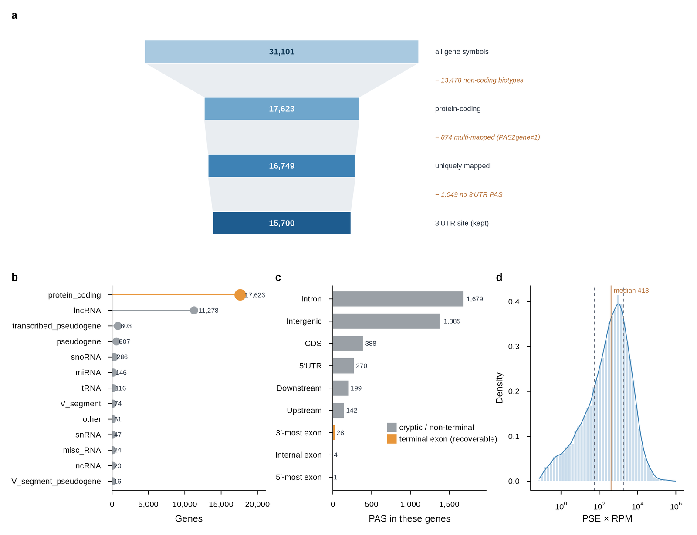

- a: funnel of PolyA_DB gene symbols through each filter
- b: gene symbols by biotype
- c: where the pA sites of genes dropped for lacking a 3′ UTR site lie
- d: PSE x RPM of the kept sites (log axis, median and IQR)
- 303,312 pA sites over 31,101 gene symbols
- removed 13,478 non-coding genes, 874 multi-mapped, 1,049 with no 3′ UTR site
- kept the 3′ UTR site with the highest PSE x RPM per gene: 15,700 genes (89.1% of protein-coding), median PSE x RPM 413
- data: `pipeline/select_constitutive_cpa.py`; plot: `plotting/sfig1.R` (panels a-c are counts, d reads the site table)

**Figure 2.2. Windows, features and models**

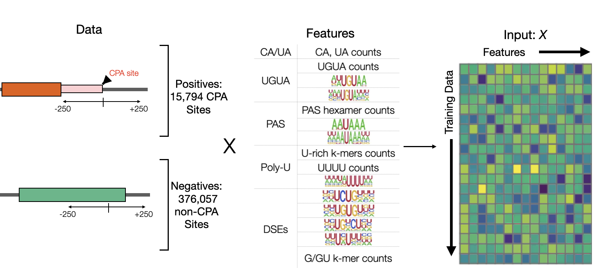

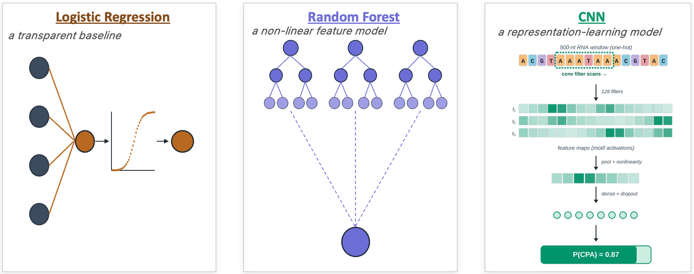

- 500 nt window, 48 bins of 30 nt, 15 feature families
- LR and RF read the feature matrix; the CNN reads one-hot sequence; each returns a probability

**Figure 2.3. Performance of the three models**

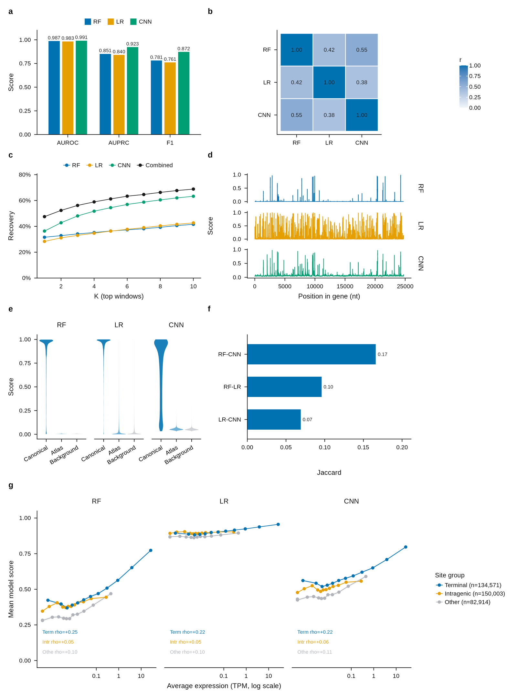

- a: AUROC, AUPRC and F1 on the test set (104,031 windows: 2,935 positive, 101,096 negative)
- b: Pearson correlation of model scores over every window of the scanned genes
- c: genes whose real end is within 250 nt of one of the top K windows, per model and best-of-three
- d: every window of ERP27 (chr12:14,913,288-14,938,537, minus strand, 24,750 windows)
- e: scores at real ends, at PolyASite clusters more than 250 nt away, and at six random windows per gene
- f: mean per-gene Jaccard of the peak sets from each pair of models
- g: score against expression for PolyASite clusters (terminal exon / intragenic / other), 12 equal-count bins

| Model | AUROC | AUPRC | F1 | Threshold |
|---|---|---|---|---|
| CNN | 0.991 | 0.923 | 0.865 | 0.37 |
| RF | 0.987 | 0.841 | 0.772 | 0.29 |
| LR | 0.983 | 0.827 | 0.758 | 0.93 |

- best-of-three puts the real end first in 47.5% of genes, in the top 10 in 68.9%
- Jaccard between model peak sets 0.07 to 0.17: the models agree on performance, not on which positions they pick
- panel a reads the test metrics from the production model metadata
- data: `pipeline/make_figure1_data.py`; plot: `pipeline/make_figure1.R`

**Figure 2.4. Derivation of the analysis set**

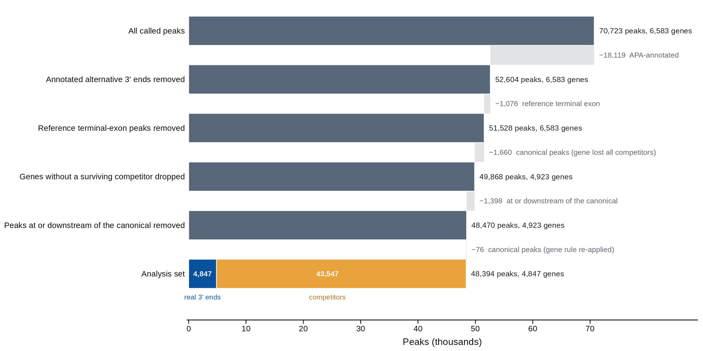

- filters act on competitors only; real ends are never removed

| Step | Removed | Left |
|---|---|---|
| all candidates | | 70,723 (6,583 real + 64,140 competitors) |
| within 500 nt of a PolyASite or PolyA_DB site, same strand | 18,119 | 46,021 competitors |
| upstream 500 nt overlaps a GENCODE v49 last exon | 1,076 | |
| genes left with no competitor | 1,660 genes | 4,923 genes |
| at or downstream of the real end | 1,398 | 43,547 competitors |
| genes left with no competitor | 76 genes | 4,847 genes, 48,394 candidates |

- competitors per gene: median 3, range 1 to 897; top 10% of genes hold 62% of competitors; Spearman rho with gene length 0.42
- data: `analysis/data_build/trace_analysis_set.py` (checks itself against `analysis/tasks/task_rerank_corr.py`, `analysis/tasks/task_upstream_blocks.py` and the parquet); plot: `plotting/make_analysis_set_funnel.R`

**Figure 2.5. Competitors carry the same sequence elements as real ends**

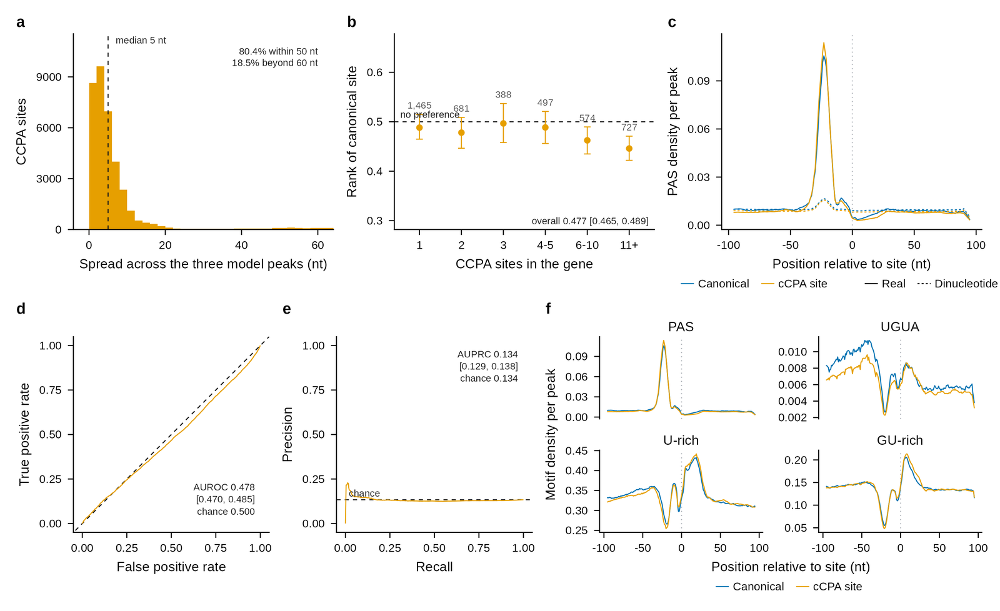

- a: spread between the three models' peak centres for 43,547 competitors
- b: APARENT2 rank percentile of the real end among its gene's competitors, by competitor count (4,332 genes)
- c: PAS hexamers per site from -100 to +100 nt, real against dinucleotide-shuffled
- d, e: APARENT2 ROC and precision-recall, real ends against competitors, on every site with an APARENT2 score (5,898 real, 38,186 competitors)
- f: as c for PAS, UGUA, U-rich and GU-rich, each on its own scale
- the models place a competitor within a median of 5 nt of each other; under 50 nt for 80.4%
- APARENT2 AUROC 0.478 (95% CI 0.470-0.485), AUPRC 0.134 against chance 0.134
- mean within-gene rank of the real end 0.477 against 0.5, flat in competitor count
- PAS peaks 23 nt upstream in both classes, about 8x shuffled
- hexamer in the 50 nt upstream: 96.1% of real ends, 98.8% of competitors (37.9% and 35.3% shuffled)
- U-rich and GU-rich downstream elements: same positions and densities
- UGUA is the one difference: 0.84 per real end against 0.68 per competitor
- PAS hexamers = AATAAA and its 12 most frequent single-substitution variants; 20 dinucleotide shuffles per sequence; 9 nt moving average
- AUROC from Mann-Whitney U, AUPRC as average precision, CIs from 1,000 bootstraps over genes
- data: `pipeline/featurize_shortlist_cpa.py`, stats: `pipeline/figure2_stats.py`; plot: `pipeline/make_figure2.R`

**Figure 2.6. Reporter assay design**

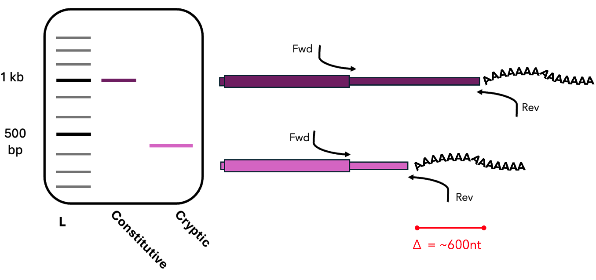

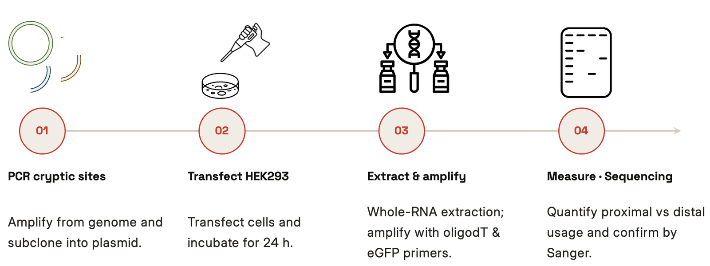

- 500 nt candidate window cloned downstream of eGFP, upstream of the vector's own pA site
- RT from anchored oligo(dT), PCR from a forward primer in the reporter: about 500 bp if the cloned site is used, about 1 kb if the vector site is used
- clone, transfect, harvest RNA at 24 h, RT-PCR, gel, Sanger

**Figure 2.7. Gels of the reporter RT-PCR products**

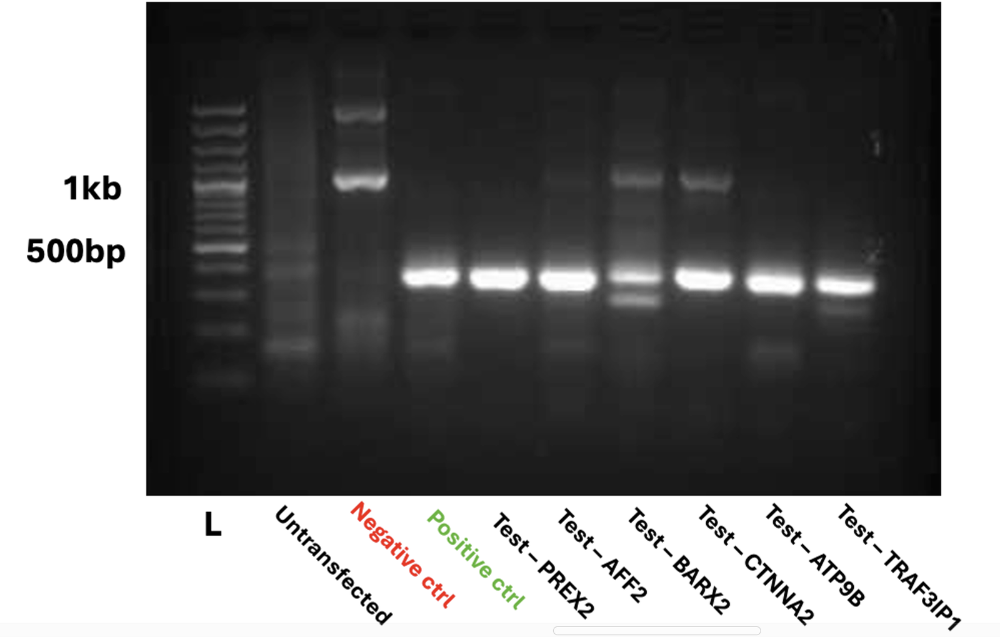

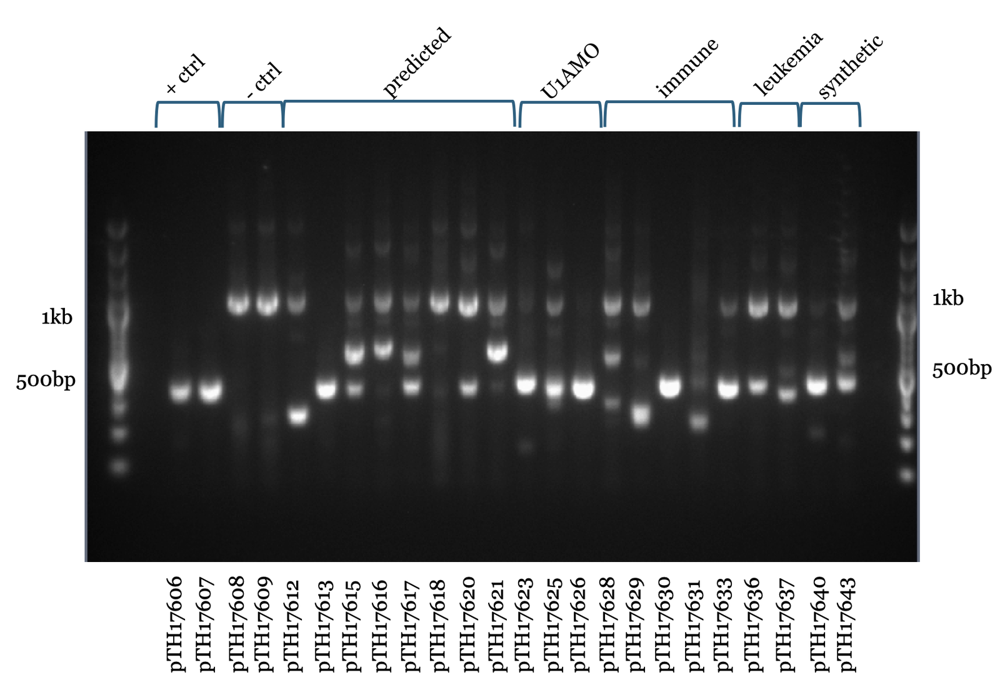

- top: ladder, untransfected, negative control, positive control, six competitor constructs (PREX2, AFF2, BARX2, CTNNA2, ATP9B, TRAF3IP1)
- bottom: 24 constructs by plasmid number: positive and negative controls, predicted competitors, U1 AMO sites, immune and leukaemia intronic pA sites, synthetic designs
- all six top-gel competitors give mainly the ~500 bp product, same as the positive control, so the cloned site is used
- two of the six also give the ~1 kb vector product, the only product of the negative control

**Figure 2.8. Sanger sequencing of the PREX2 and AFF2 products**

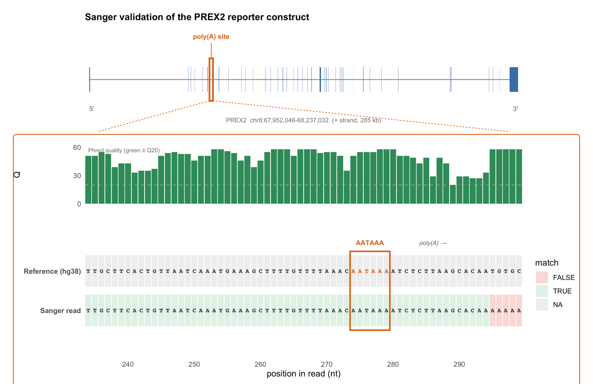

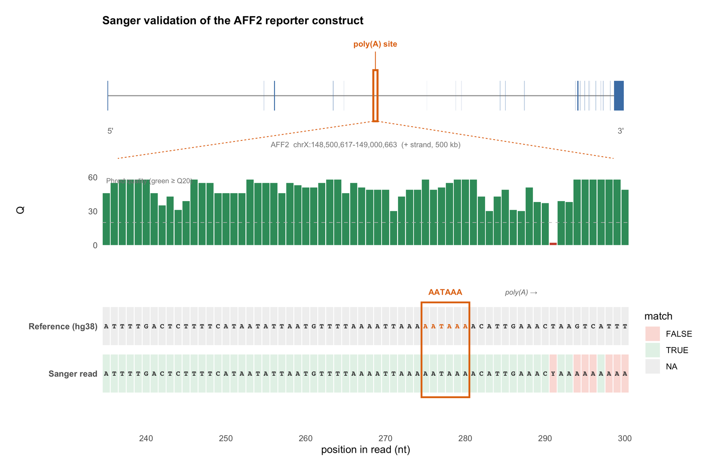

- per construct: position of the cloned site in the gene, Phred quality per base (line at Q20), alignment to hg38 with the AAUAAA marked
- reads end in a poly(A) tail starting downstream of the cloned AAUAAA
- PREX2 chr8:67,952,046-68,237,032 (+); AFF2 chrX:148,500,617-149,000,663 (+)

**Table 2.1. Competitor sites tested in the reporter assay**

- 18 rows: gene, hg38 coordinates of the 500 nt window, strand, score
- rows match `Cryptic_CPA_sites.hg38.tested_experimental.bed`, a subset of the 40,537-site `Cryptic_CPA_sites.hg38.bed`
- score = the earlier baseline random forest (Shkurin, Pour and Hughes, "Known sequence features can explain half of all human gene ends"), not the chapter 2 consensus
- SHLD2, MYLK, KIF13A and TBL1X have no construct on either gel

**Reporter constructs**

- inserts and primers: [reporter_constructs.tsv](reporter_constructs.tsv) and [reporter_constructs.fa](reporter_constructs.fa) (name, plasmid, category, hg38 window, selection metrics, insert sequence)
- backbone pTH13195 (eGFP reporter); inserts cloned between FseI and EcoRI; some cloned in-house, some synthesised by Bio Basic
- primers: forward in eGFP and anchored oligo(dT) for RT, both with Illumina Nextera adapter prefixes

| Group | Plasmids | n | Insert | Chosen because |
|---|---|---|---|---|
| positive control | pTH17606 (ACTB), pTH17607 (GAPDH) | 2 | 484 nt | annotated, heavily used 3′ ends |
| negative control | pTH17608 (CTCF region), pTH17609 (GAPDH region) | 2 | 484 nt | genomic windows with no pA site |
| predicted competitors, bottom gel | pTH17612 MYDGF, 17613 ZSWIM5, 17615 FAM9B, 17616 CDH13, 17617 RHOJ, 17618 RYR1, 17620 CACNA2D3, 17621 DCAF17 | 8 | 484 nt | intronic windows scored as high as the gene's real end (0.694 to 0.775) |
| predicted competitors, top gel | CR_1 PREX2, CR_2 AFF2, CR_3 BARX2, CR_4 CTNNA2, CR_5 ATP9B, CR_6 TRAF3IP1 | 6 | 500-501 nt | highest-scoring competitors in Table 2.1 (0.827 to 0.855) |
| U1 AMO sites | pTH17623, 17625, 17626 | 3 | 484 nt | intronic sites that appear when U1 is inhibited (Oh et al. 2017), by maxlog2fc 5.7 to 11.7 |
| immune intronic pA sites | pTH17628 C1orf228, 17629 NF1, 17630 ANKRD28, 17631 FCRL5, 17633 PRDM1 | 5 | 484 nt | intronic pA sites in immune cells (Singh et al. 2018), composite score 23.3 to 37.5 |
| leukaemia intronic pA sites | pTH17636 RAPGEF3, 17637 MAP4K4 | 2 | 484 nt | CLL against normal B cells and tissue (Lee et al. 2018), score 22.8 to 23.7 |
| synthetic designs | pTH17640, pTH17643 | 2 | 484 nt | designed sequences |

**Reporter protocols**

- cloning: FseI + EcoRI, Antarctic phosphatase, T4 ligase (NEB), Subcloning Efficiency DH5-alpha
- transfection: HEK293T and HeLa, Lipofectamine 2000 in Opti-MEM, doxycycline induction, harvest after one day
- extraction: AllPrep DNA/RNA Mini (QIAGEN), RNA and gDNA from the same well
- RT: SuperScript III, anchored oligo(dT); RNA 8.5 uL + primer 0.5 uL (100 uM) + dNTPs 1 uL (10 mM), 80 C 5 min to 42 C; add 4 uL 5x buffer, 1 uL 0.1 M DTT, 1 uL RNaseOUT, 1 uL SSIII, 3 uL water; 42, 48, 55 C for 15 min each, 80 C 5 min
- PCR: Phusion in GC buffer with 0.5 M betaine and 10% DMSO, 30 cycles of 98 / 68 / 72 C; gDNA control uses a reverse primer downstream of the vector pA site
- readout: agarose gel, bands cut and purified (QIAquick), Sanger

**Figure 2.9. Overlap of competitors with published poly(A) site sets**

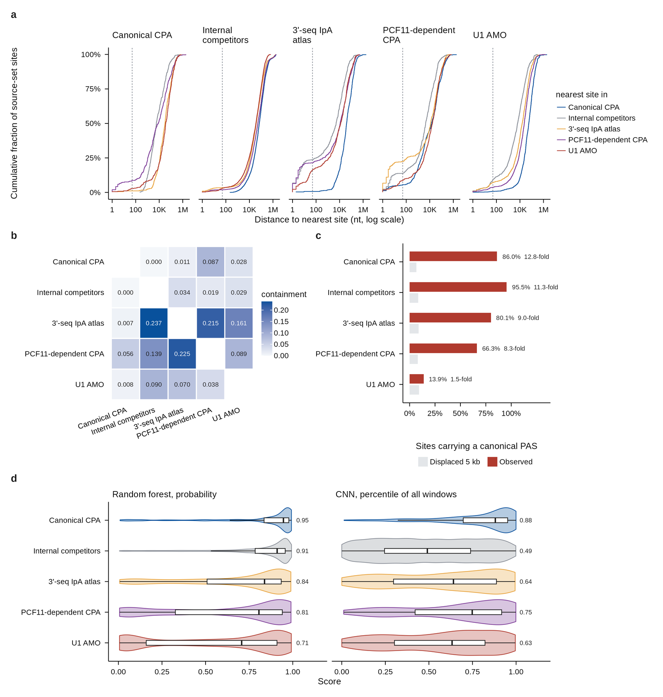

- five site sets restricted to the 334 protein-coding genes where every set has at least one site: 356 real ends, 4,027 competitors, 573 immune/leukaemia 3′-seq sites, 1,306 U1 AMO sites, 552 PCF11-dependent sites
- competitors here are all 64,140 from the 6,583 contested genes, not only the analysis set
- a: distance from each site to the nearest site of each other set in the same gene (log axis, dashed line at 50 nt)
- b: fraction of each row's sites within 50 nt of a site in each column
- c: AAUAAA or AUUAAA in the 60 nt upstream, against the same positions moved 5 kb
- d: RF (calibrated probability) and CNN (percentile among all 70,723 peaks) at each set's sites
- published sets agree with each other only 16 to 24% within these genes
- AAUAAA/AUUAAA upstream: 95.5% of competitors, 86.0% of real ends, 80.1% immune/leukaemia, 66.3% PCF11-dependent, 13.9% U1 AMO
- U1 AMO sites are unstranded, so panel c reads them on the + strand; that row is not comparable to the others
- whole-competitor version (section 2.2.7): 370 of 43,547 competitors are within 50 nt of any published site; 273 of 39,970 U1 AMO sites (0.68%, 3.9x chance, P < 0.005), 83 of 39,972 control-morpholino sites (0.21%, 1.2x, P = 0.065), 19 of 5,451 immune/leukaemia sites (0.35%, 2.1x, P = 0.015); over 99% of competitors match nothing published
- match = within 50 nt, same strand where stranded; chance = mean over 200 shifts of 10-100 kb (smallest P 0.005)
- hg19 sets lifted to hg38 with liftOver -minMatch=0.95

| Set | Publication | Accession |
|---|---|---|
| immune (part of 3′-seq atlas) | Singh et al. 2018 | GSE111310 |
| leukaemia (part of 3′-seq atlas) | Lee et al. 2018 | GSE111793 |
| U1 AMO and control morpholino | Oh et al. 2017 (HeLa, unstranded) | GSE103252 |
| PCF11-dependent | Kamieniarz-Gdula et al. 2019 | GSE123105 |

- PCF11-dependent = at least 3-fold higher in siLUC than siPCF11, i.e. sites lost on PCF11 knockdown (HeLa nuclear QuantSeq REV)
- site sets: `analysis/data_build/hiconf_sets.py` (tolerance 50 nt, min reads 2, enrichment 3, merge 25 nt)
- scores: `analysis/other/overlap_model_scores.py`, `analysis/other/overlap_rf_dense.py`; panels a-c: `analysis/other/overlap_shared_recompute.py`; plot: `plotting/make_figure_overlap_shared.R`
- whole-competitor version: `analysis/tasks/task_overlap_accounting.py`, `pipeline/03_simple_overlap.py`, `plotting/make_figure_overlap.R`
- downloads: `pipeline/00_download_and_liftover.sh`, `jobs/fetch_gsm.sh`

**Chapter 3 shared inputs**

- network dataset `cnn_data.npz` (`analysis/networks/cnn_data.py`): the analysis set, 48,394 windows x 2,500 nt, -2,000 to +500 around each candidate in transcript orientation
- fixed split: test chr1, 8, 15, 21 plus a 20% gene holdout (seed 42); validation chr3, 18; train the rest. Train 2,781 genes / 27,658 candidates, validation 443 / 6,538, test 1,623 / 14,198 (1,623 real, 12,575 competitors)
- LOCO: 23 folds, one per chromosome, 25% of the remaining genes held out in each fold for tuning
- per-peak MaxEnt table `fig3_ucube_meta.tsv` (`pipeline/figure3_data.py`): best score3 from -2,000 to -126 nt (`acc`), best score5 between that acceptor and the candidate (`interv_donor`)
- MaxEntScan through maxentpy 0.0.3; score3 on 23-mers with the AG at positions 18-19; score5 from a 4^9 lookup
- U1 duplex -dG from a 4^9 lookup, ViennaRNA 2.6.4 duplexfold against ACUUACCUG
- thresholds: score3 >= 6.5, score5 >= 8, U1 -dG >= 4 (>= 7 strict)
- matched intronic decoys (`analysis/tasks/task_b16.py`): positions every 25 nt in GENCODE introns, at least 1 kb from any PolyASite cluster, 5 per competitor matched on distance to the real end and to the nearest 3′ and 5′ splice sites; 30,000 drawn at seed 42
- networks (`analysis/acceptor/acceptor_arch_train.py`, architecture in `analysis/networks/cnn_model_def.py`): 32 first-layer filters of width 19 with exponential activation, pooling by 10, 5, 2 to 25 positions (378 nt receptive field, 100 nt stride), 2,400 values, one 64-unit dense layer; BCE with pos_weight, Adam lr 1e-3, weight decay 1e-6, batch 128, dropout 0.4, up to 60 epochs, patience 10 on holdout win-rate; five seeds (42-46)
- LOCO network scores: `analysis/networks/cnn_loco_train.py` (Figures 3.9, 3.10c) and `analysis/networks/cnn_wg_loco.py` (Figure 3.14); both give analysis-set P@1 0.681
- statistics for every cited test: `thesis_ch3/analysis/stats_ch3.py`
- motifs: CISBP-RNA 2.00 (Ray et al. 2013), 544 matrices
- regrouped figures (3.3, 3.4, 3.6, 3.7, 3.8, 3.9, 3.11): `thesis_ch3/figures/fig3_regroup.R` runs the panel scripts through `thesis_ch3/figures/_harvest.R` and reassembles them

**Figure 3.1. The comparison**

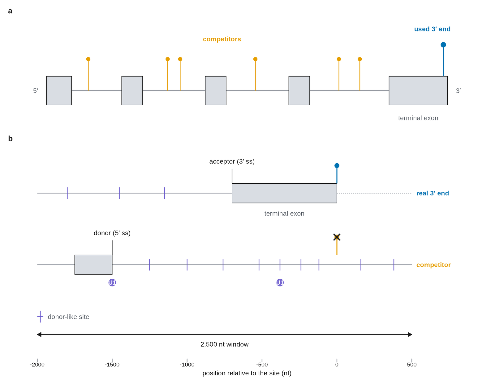

- a: gene model with the annotated 3′ end in the terminal exon (blue) and intronic competitors (orange); competitors are sites all three chapter 2 models score at or above the annotated end
- b: the 2,500 nt window the chapter 3 models read, drawn for a real end and for a competitor as the hypothesis predicts (donor-like sites that can pair with U1, U1 bound, cleavage not used)

**Figure 3.2. Gene sets and how performance is measured**

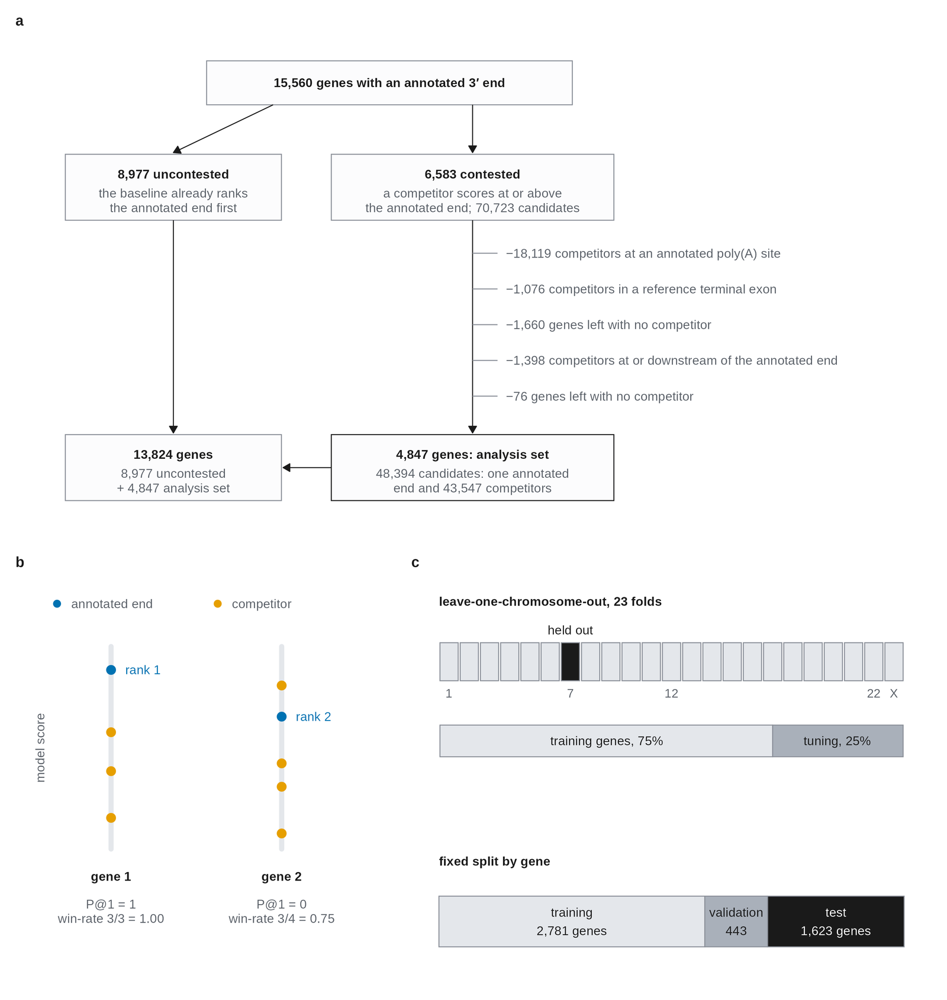

- a: 15,560 scanned, 8,977 uncontested, 6,583 contested (70,723 candidates), 4,847 analysis set (48,394 candidates, 43,547 competitors), 13,824-gene union
- b: the two within-gene measures on two example genes: P@1 (real end ranked first) and win-rate (fraction of competitors scoring below the real end)
- c: 23-fold LOCO with a 25% inner gene holdout, and the fixed split by gene
- chance P@1 on the analysis set 0.287 (mean over genes of 1/n)
- competitors per gene 1 to 897, median 3; top 10% of genes hold 61.9% of competitors; Spearman rho with gene length 0.42
- `thesis_ch3/figures/fig3_02_genesets.R`

**Figure 3.3. Splicing environment upstream of real ends and competitors**

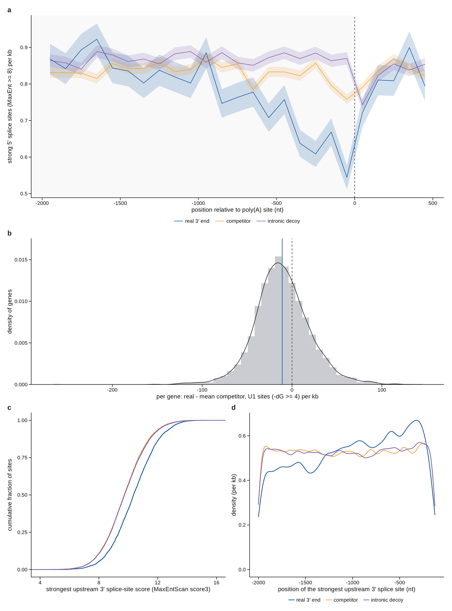

- 4,847 real ends, 43,547 competitors, 30,000 matched intronic decoys
- a: strong 5′ splice sites (score5 >= 8) per kb in 100 nt bins, -2,000 to +500, ribbons +/- 1 SEM
- b: per-gene difference in U1 site density (-dG >= 4), real end minus the gene's competitors, 4,847 genes
- c: cumulative distribution of the best upstream score3 (-2,000 to -126 nt)
- d: position of that acceptor for sites with best score3 >= 6.5 (99% of sites)
- strong donors per kb over the 500 nt upstream: 0.643 real, 0.813 competitor, 0.875 decoy; downstream equal (0.81 / 0.83 / 0.82)
- within gene: -0.24 donors per kb [0.20, 0.28], z = -10.8, r = 0.18
- U1 sites: -10.9 per kb at real ends, lower in 67% of genes, z = -25.4 (Wilcoxon on 4,836 genes after 11 zero differences)
- best upstream acceptor median score3: 10.35 real, 9.72 competitor, 9.74 decoy; within gene +0.58, higher in 62% of genes, z = 21.1
- acceptor within 1 kb upstream: 51.8% of real ends, 46.7% of competitors, z = 6.7
- acceptor score alone ranks the real end first in 38.5% of genes
- a, b: `plotting/make_splicing_environment.R` from `analysis/splice_model/splice_score_redundancy.py`; c, d: `thesis_ch3/figures/fig3_regroup.R` from `analysis/acceptor/acceptor_position_scan.py`

**Figure 3.4. Donor scores, thresholds and background rates**

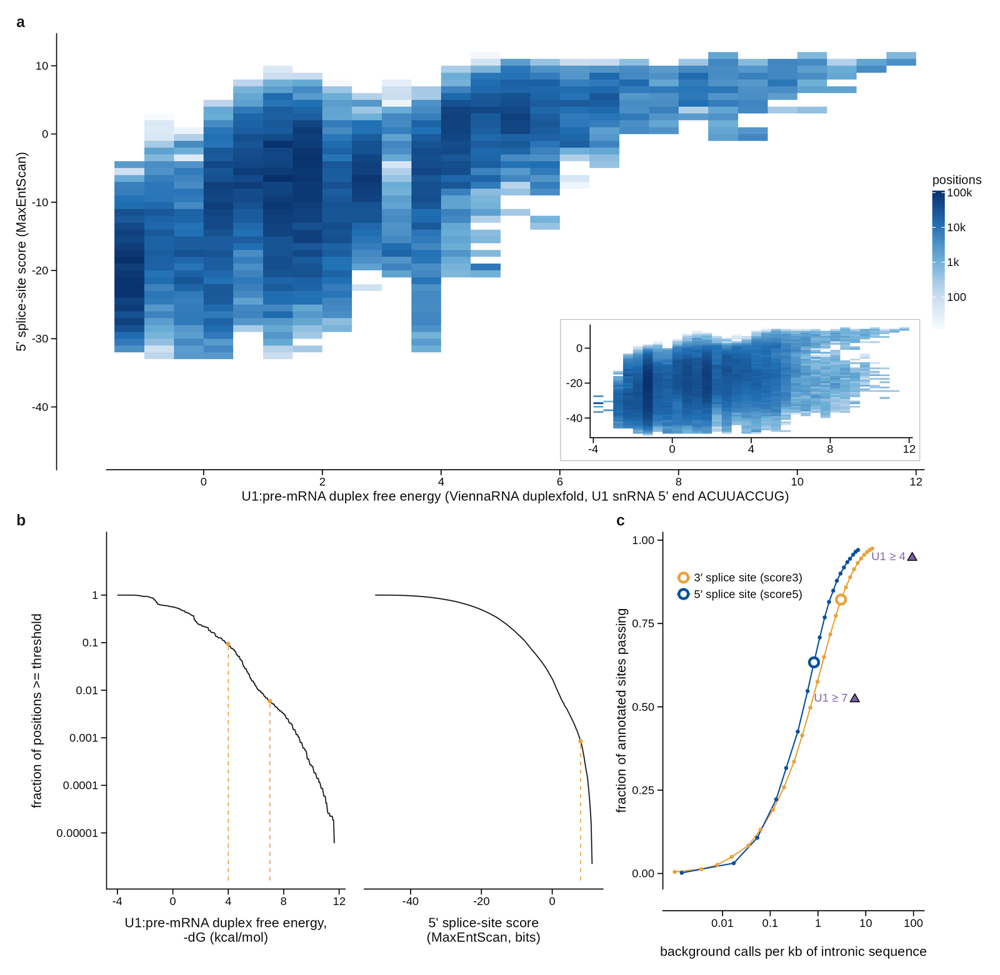

- a: U1 duplex -dG against MaxEnt score5 over 10,723,361 GT-anchored 9-mers; inset over all 196,063,340 positions
- b: fraction of positions at or above each score, with -dG >= 4, -dG >= 7 and score5 >= 8 marked
- c: thresholds 2 to 14 (step 0.5): sensitivity at annotated GENCODE splice sites against calls per kb in competitor windows; circles at score3 >= 6.5 and score5 >= 8, triangles at U1 >= 4 and >= 7
- score5 and U1 -dG: r = 0.692 over GT-anchored positions, 0.356 over all positions
- exceedance: -dG >= 4 at 9.40% of positions, >= 7 at 0.59%, score5 >= 8 at 0.084%
- score3 >= 6.5: sensitivity 0.822, 3.03 calls per kb, at least one call in 98.5% of competitor windows
- score5 >= 8: sensitivity 0.633, 0.82 calls per kb
- U1 -dG >= 4: 94.7% of annotated donors, 94 calls per kb
- composition: 9.2% of positions pass U1 >= 4 against 8.4% after dinucleotide shuffling, so 92% of the signal is composition (>= 85% at every threshold from 1 to 10)
- composition-corrected features lowered performance, so thresholds sit on this curve instead
- a, b: `plotting/make_splicing_environment.R`; c: `thesis_ch3/analysis/maxent_calibration.py`, `thesis_ch3/analysis/u1_calibration.py`; composition: `thesis_ch3/analysis/u1_null_analysis.py`

**Figure 3.5. The hypothesis tested directly**

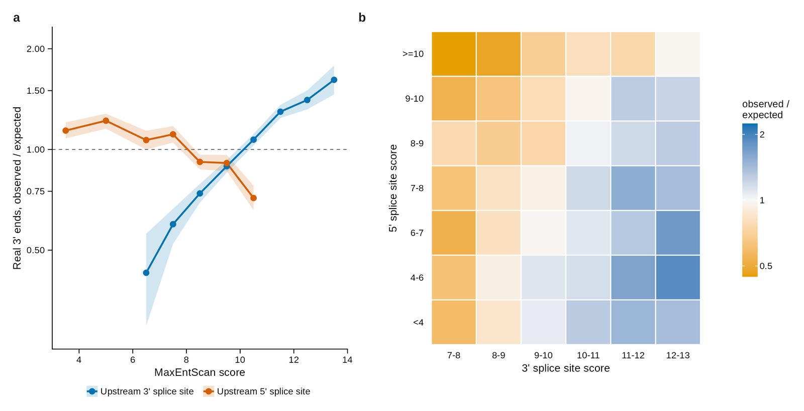

- analysis set (4,847 genes, 48,394 candidates)
- observed / expected real ends, where expected = sum over the group of 1/n (n = candidates in the gene); 1 = the group's fair share
- a: by best upstream score3 (blue) or best score5 between that acceptor and the candidate (orange), log2 axis, 95% bootstrap ribbons over genes, groups under 200 candidates dropped
- b: both scores jointly; all 42 cells of the 6 x 7 grid have >= 200 candidates; blue above 1, orange below
- acceptor: 0.43 at score3 6-7 rising to 1.62 at >= 13, monotone
- donor: 1.14, 1.22, 1.07, 1.11 below score5 8, then 0.92, 0.91, 0.72 at >= 10; reversed relative to the acceptor, peaking at 4-6
- conditional logit within gene: acceptor OR per SD 1.474 [1.424, 1.527], P = 3.5e-106; donor OR 0.930 [0.900, 0.960], P = 7.8e-6; interaction 0.989, P = 0.50 (no interaction)
- grid: 0.447 (score3 7-8, score5 >= 10) to 1.887 (score3 12-13, score5 4-6)
- by fifths: 0.67 to 1.48 for the acceptor, 1.22 to 0.83 for the donor
- `thesis_ch3/analysis/hypothesis_grid.py`, `thesis_ch3/analysis/hypothesis_dose.py`; plot: `thesis_ch3/figures/fig3_hypothesis_dose.R`

**Table 3.1. Same test with the poly(A) signal held fixed**

- genes where the real end and at least one competitor both carry AAUAAA 10-35 nt upstream, within 3 nt of each other: 2,313 genes, 10,022 competitors
- real end minus the mean of the gene's competitors, median over genes, Wilcoxon signed-rank, r = |z|/sqrt(n)
- acceptor +0.50 (z = 12.2, r = 0.25, P = 3.2e-34); splicing differences persist, cleavage-element differences do not
- UGUA: z = +4.4 but the real end is higher in only 38% of genes
- canonical-PAS subset 3,857 genes / 27,114 competitors
- `thesis_ch3/analysis/pas_controlled.py`

**Figure 3.6. The 26-feature splice model**

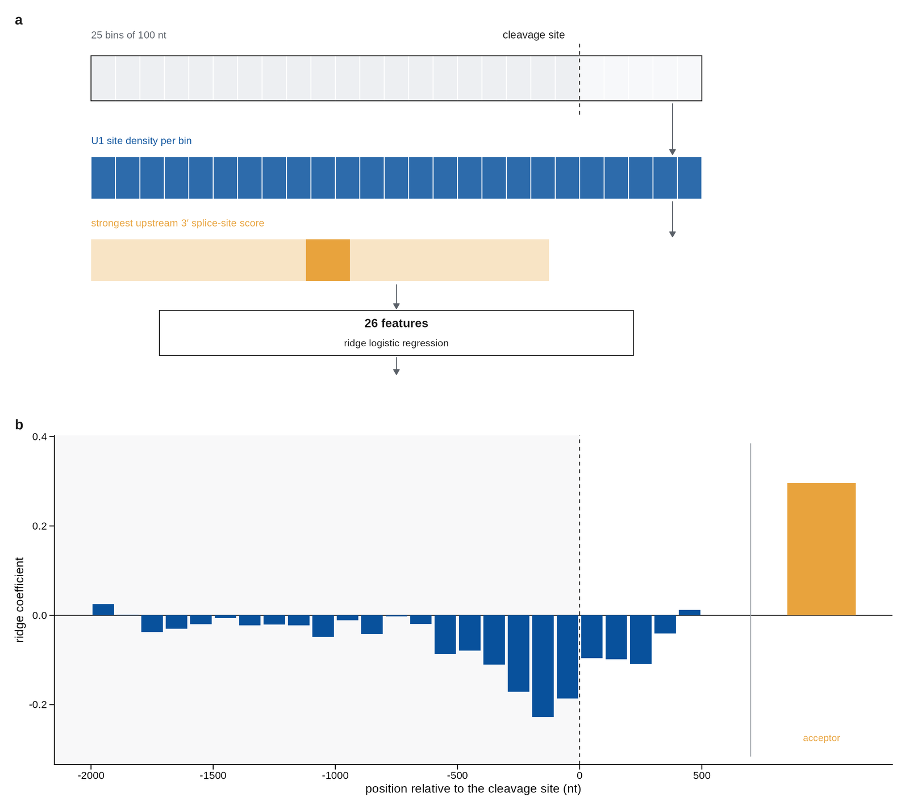

- a: 25 bins of 100 nt, each its U1 site density (-dG >= 4) per kb, plus the best score3 from -2,000 to -126 nt
- b: fitted coefficients
- features centred within gene and scaled; ridge logistic regression (IRLS), seed 42, 25% inner holdout, lambda grid 0.1 to 1e4, chosen lambda 0.1 (bottom of the grid)
- U1 coefficient most negative near the site: -0.23 at [-200, -100); acceptor +0.30
- `analysis/splice_model/splice_model_26.py` with `analysis/splice_model/binned_common.py`, `analysis/splice_model/binned_profile_scan.py`, `analysis/data_build/cache_analysis_columns.py`; plot: `plotting/make_splice_model_final.R`

**Figure 3.7. Within-gene performance of the splice model**

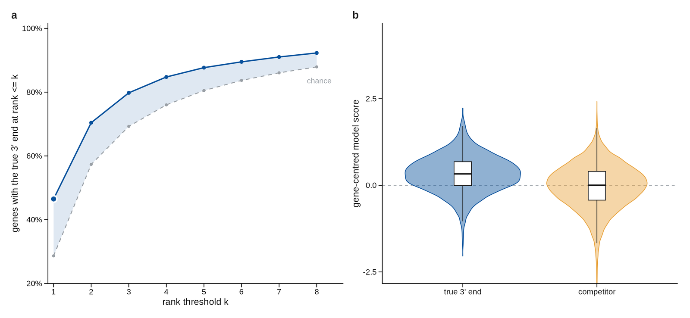

- a: genes whose real end ranks in the top k, against chance (mean of min(k, n)/n)
- b: score minus the gene mean over all candidates; medians +0.33 real, +0.00 competitor
- P@1 0.465 [0.451, 0.479] against 0.287; top-3 0.798 against 0.693; win-rate 0.699 [0.689, 0.710]
- 75% of real ends score above the mean of their own competitors; median margin over competitors +0.48, z = 37.1, r = 0.53 (a different quantity from panel b)
- 176 positional features: P@1 0.494; convolution over bins 0.512 (`thesis_ch3/analysis/splice_positional_features.py`, `thesis_ch3/analysis/splice_model_boost.py`)
- two-feature arrangement model 0.392 and 0.396, five-fold CV by gene rather than LOCO (`thesis_ch3/analysis/splice_model_expand.py`)
- a: `analysis/splice_model/recall_at_k.py` (LOCO, lambda retuned per fold, 2,000 bootstraps); b: `analysis/splice_model/score_separation.py`; plot: `plotting/make_splice_model_final.R`

**Figure 3.8. What each model reads, and the network architecture**

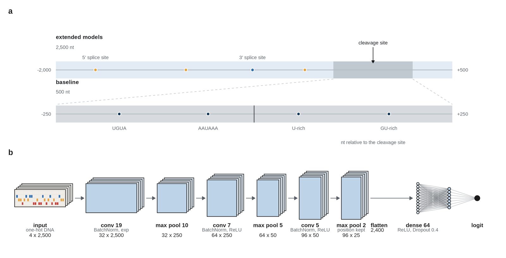

- a: chapter 2 baseline scores ten poly(A) elements in 30 nt windows at 10 nt stride across 500 nt (four drawn); chapter 3 models read 2,500 nt of sequence; acceptor orange, donor blue as in Figures 3.11 and 3.12
- b: 32 filters of width 19, exponential activation, pooling by 10, 5, 2 to 25 positions (378 nt receptive field, 100 nt stride), 2,400 values, 64-unit dense layer, one output
- a: `plotting/make_figure_rescue.R`; b: `plotting/make_figure_architecture.R`

**Figure 3.9. Sequence network against the splice-feature model**

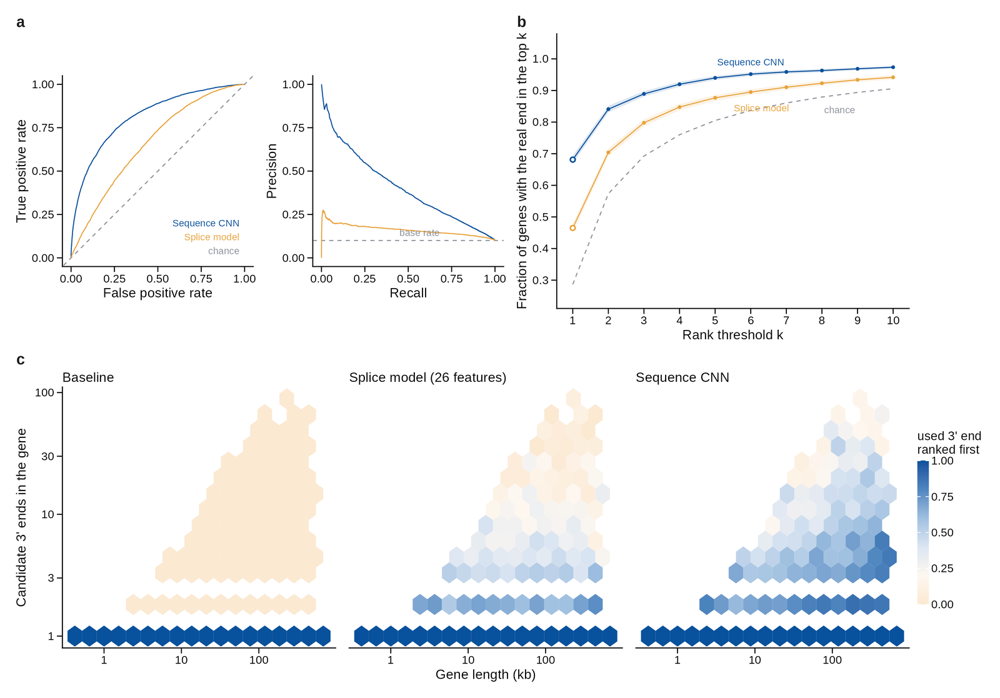

- blue network, orange splice model, same LOCO folds
- a: ROC and precision-recall pooled over all candidates, base rate 0.100
- b: genes whose real end ranks in the top k, 95% bootstrap bands
- c: P@1 by gene length and candidate count for the baseline, splice model and network; 15,475 genes with a GENCODE span; hexagons with at least 12 genes
- analysis-set P@1: network 0.681 [0.669, 0.695], splice model 0.465, chance 0.287
- win-rate 0.847 against 0.699
- AUROC / AUPRC: 0.815 / 0.407 against 0.661 / 0.162
- per-chromosome network win-rate 0.820 to 0.897
- network alone wins 1,515 genes, splice model alone 457 (chi2 = 567, P = 3e-125); win-rate difference 0.148, z = 22.6, r = 0.43
- both degrade with more candidates and longer genes; the network degrades more slowly
- `analysis/networks/cnn_loco_train.py`, `analysis/figure_data/loco_figure_data.py`, `analysis/networks/cnn_wg_loco.py`, `analysis/figure_data/wg_by_length.py`; plot: `plotting/make_figure_loco.R`

**Figure 3.10. Robustness**

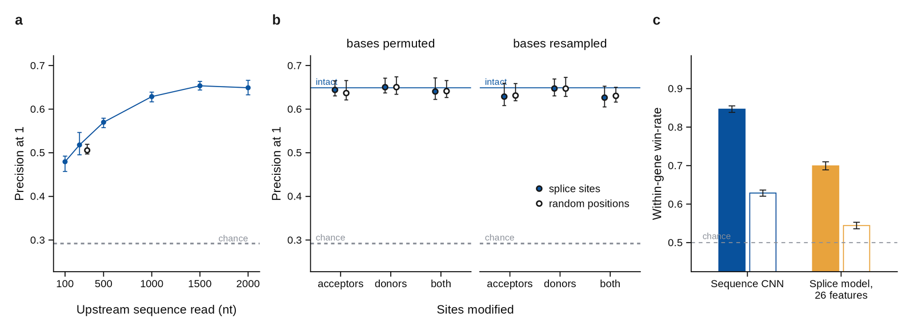

- a, b on the fixed split (1,623 held-out genes, 14,198 candidates); c on LOCO
- a: P@1 as the window is cut back from the upstream end; open circle for -250 to +250; mean of five seeds, bars the range
- b: P@1 of the five networks (not refitted) when strong 3′ sites, 5′ sites or both are modified (filled) or the same number of random positions (open); left permuted, right resampled; -40 to +40 left alone
- c: win-rate on real sequence against dinucleotide shuffles (3 replicates)
- context: 0.479 (-100), 0.518 (-250), 0.570 (-500), 0.629 (-1000), 0.653 (-1500), 0.649 (-2000); -250 to +250 gives 0.506; saturates near -1,500
- splice-site modification: no change (all P >= 0.12); strong sites are a median 7 acceptor and 2 donor calls, 179 nt, 7% of the window
- so the network doesn't rely on the sites themselves; with c, its signal is spread over the window (the context the sites sit in)
- shuffling: win-rate 0.847 to 0.629 (network), 0.699 to 0.544 (splice model)
- acceptor score as an extra network input (text only, no panel): 0.839 +/- 0.009 with the acceptor score, 0.832 +/- 0.013 without, Welch P = 0.22; acceptor score alone win-rate 0.620, P@1 0.397
- chance P@1 on this split 0.292
- a: `thesis_ch3/analysis/context_sweep.py`; b: `thesis_ch3/analysis/splice_scramble.py`, `thesis_ch3/analysis/patching.py`; acceptor-score input: `analysis/acceptor/acceptor_arch_train.py`; plot: `thesis_ch3/figures/fig3_09_robustness.R`

**Figure 3.11. First-layer filters and splice-site implantation**

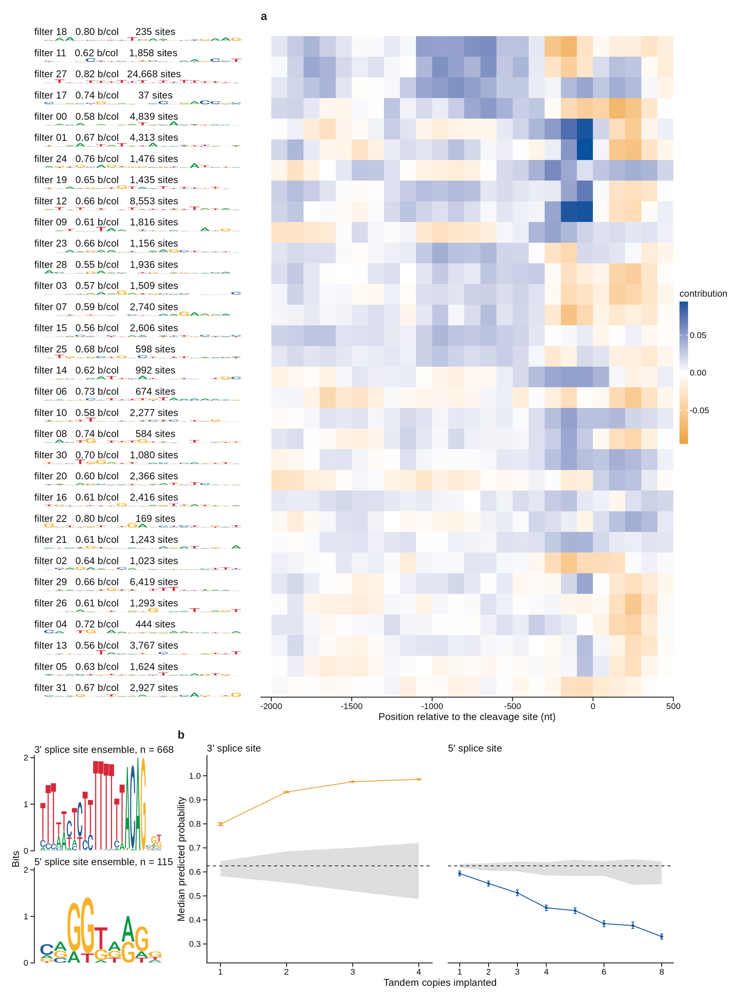

- seed-42 network, held-out genes (1,623 real ends, 12,575 competitors)
- a: logo for each of the 32 filters (from sites above 30% of the filter's maximum, in a random 4,000 of the 14,198 held-out windows) and each filter's contribution per 100 nt band over all 14,198 windows
- contribution = mean drop in logit when the filter is silenced; blue raises real ends
- b: median predicted probability of the 12,575 competitors after writing tandem copies of a 3′ splice site (score3 10.28) or CAGGTGAGT (score5 10.67) at -230 nt; 95% bootstrap bars (2,000); dashed line the unmodified median; grey band the means +/- SE of 20 mononucleotide shuffles and the nine base derangements
- acceptor logo: sampled against the network over 23-mers with the AG fixed and score3 >= 10 (n = 668); donor logo: all 262,144 9-mers by U1 duplex energy (n = 115)
- unmodified median 0.625 [0.616, 0.634]
- acceptor x1 0.799 [0.792, 0.805], x4 0.985; donor x1 0.593 [0.584, 0.604], x8 0.331
- MaxEnt-optimal acceptor: -0.138 (z = -0.5, P = 0.66); sequence optimised against the network: +1.880 (z = 15.4); pyrimidine tract: +0.830 (`analysis/acceptor/acceptor_agdep_search.py`, `analysis/acceptor/acceptor_floor_sweep.py`)
- AG to AC in the network-optimised acceptor raises the score by 0.034 (1.880 to 1.915), so the AG is not what the network reads
- concept erasure (`thesis_ch3/analysis/concept_erasure.py`): the network encodes base composition and U1-site density, not MaxEnt scores, PAS or annotated splice sites
- native element removal (`thesis_ch3/analysis/interpret_deep.py`): removing UGUA costs 0.23 to 0.25 logit, the largest effect; the PAS costs 0.04
- a: `analysis/networks/cnn_posmap_occlusion.py`, `analysis/networks/cnn_interpret2.py`, `analysis/figure_data/figure_cnn_main_data.py`; b: `analysis/figure_data/panelB_prob_ci.py`, `analysis/acceptor/me3_pwm.py`, `analysis/u1/u1_pwm.py`, `analysis/acceptor/model_acc_pwm.py`; plot: `plotting/make_figure_cnn_interpretability.R`

**Figure 3.12. In silico tests of splicing and cleavage signals**

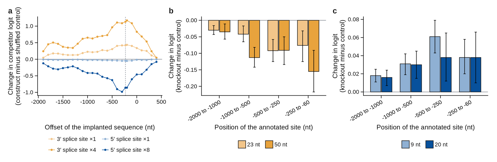

- five networks, not refitted, held-out genes
- a: implanting the 3′ splice site (1 or 4 copies) or CAGGTGAGT (1 or 8 copies) at each offset in 12,575 competitor windows, minus three mononucleotide shuffles; -230 nt marked
- b: replacing the annotated terminal-exon 3′ splice site (23 nt, 1,010 windows; or 50 nt, 1,003 windows) in real-end windows with composition-matched bases, minus the same at three random positions, by distance
- c: the same for the nearest annotated upstream 5′ splice site (9 nt or 20 nt) in 2,223 competitor windows
- 50 nt acceptor knockout lowers the logit by 0.086 overall [0.069, 0.102], 0.155 within 250 nt, 0.035 beyond 1 kb
- donor knockout: +0.030 overall, +0.061 at 250-500 nt upstream (opposite sign)
- P@1 0.730 to 0.713 on acceptor knockout
- a: `thesis_ch3/analysis/implant_position.py`; b, c: `thesis_ch3/analysis/mechanism.py`, `thesis_ch3/analysis/fig_mech_data.py`; plot: `thesis_ch3/figures/fig3_13_mechanism.R`

**Figure 3.13. RNA-binding protein motif screen**

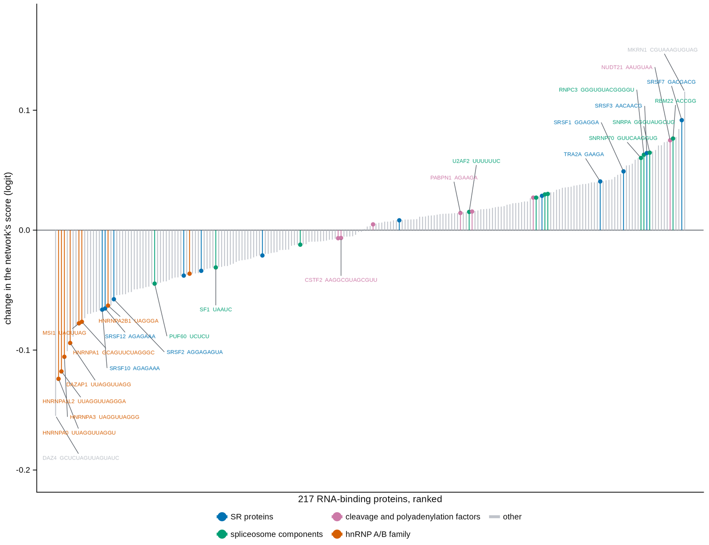

- 217 human proteins in CISBP-RNA: change in logit when sequences sampled from the motif are written into 3,000 held-out competitor windows, minus permutations of the same bases, averaged over five networks
- written at -1,000, -300, -200, -100 and +50 nt; each protein at its largest-magnitude motif and offset; ranked, labelled with protein and consensus, coloured by family
- 212 of 217 have a CI excluding zero
- range -0.155 (DAZ4) to +0.116 (MKRN1)
- most negative: DAZ4, HNRNPA0 (-0.124), HNRNPA1L2 (-0.118), HNRNPA3 (-0.106); all carry UAG or UUAG
- NUDT21 (CFIm25, AAUGUAA) +0.075, sixth; SRSF7 +0.092; SNRPA (U1A) +0.065; SNRNP70 (U1-70K) +0.060; CSTF2 (CstF64) -0.007; U2AF2 and PTB +0.015
- `thesis_ch3/analysis/implant_cisbp.py` (columns >= 0.25 bits, at least 4 columns, 3,000 windows, 2 permutations, 500 bootstraps); plot: `thesis_ch3/figures/fig3_implant_panel.R`

**Figure 3.14. How often the annotated 3′ end is ranked first**

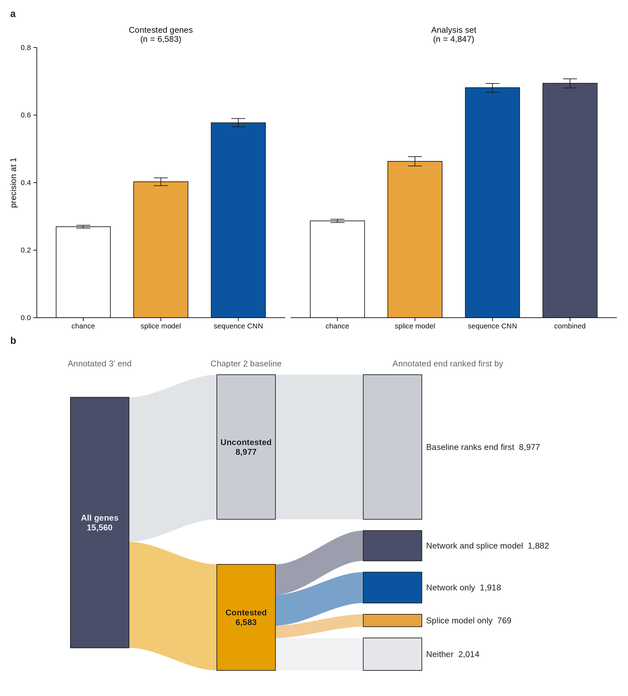

- a: P@1 on the contested genes (6,583 genes, 70,723 candidates) and the analysis set (4,847 genes, 48,394 candidates), against chance, 95% bootstrap intervals (2,000); combined = sum of the two models' within-gene standardised scores; all LOCO
- b: all 15,560 genes: uncontested, then contested split by which model ranks the annotated end first
- analysis set: network 0.681, splice model 0.463 (fixed lambda 0.1), combined 0.694 [0.681, 0.707], chance 0.287; combined over network: McNemar 447 against 384, P = 0.031
- contested: network 0.577, splice model 0.403, chance 0.270; difference 17.5 points, P = 1e-108
- genome-wide: network 0.821, splice model 0.747, baseline 0.577
- contested branches: both 1,882, network only 1,918, splice model only 769, neither 2,014
- ranks break ties in the model's favour
- `analysis/other/rescue_ranks.py`, `analysis/splice_model/splice26_loco.py`; plot: `thesis_ch3/figures/fig3_14_recovery.R`

**Notes**

- two splice-model LOCO fits: lambda retuned per fold gives P@1 0.465 (Figures 3.7, 3.9); fixed lambda 0.1 gives 0.463 (Figure 3.14); with the first fit the network-minus-splice difference is 21.6 points
- binarised acceptor/donor rule (`analysis/splice_model/rule_2x2_final.py`): 1.08-fold over base rate; score3 >= 8 admits 91% of peaks
- linear joint score z(acc) - z(donor) (`analysis/splice_model/joint_score_final.py`): lowers AUROC; cannot express an acceptor-conditional sign flip
- confound: the upstream 500 nt is 89% exonic for real ends and 1.5% for competitors; exonic fraction alone gives P@1 0.945 (circular). Figure 3.5 holds against matched intronic decoys, and with both sites >= 90% exonic and <= 10% repeat the network still wins 0.625 of pairs
